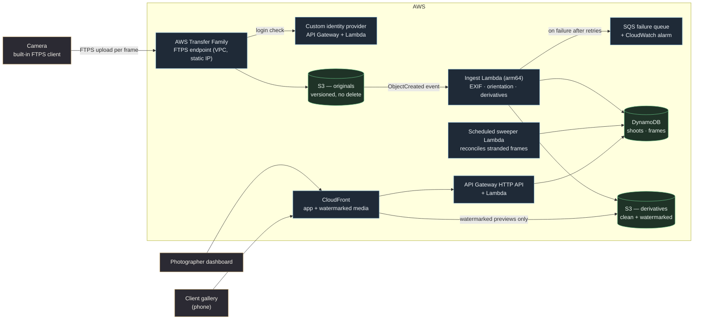

# Kint — Real-Time Event Photo Delivery on AWS

**A case study.** Kint is a serverless platform I designed and built that delivers photos to clients *while an event is still happening*: the camera uploads each frame as it's shot, and the client watches a private gallery fill in on their phone a few seconds later.

This repository is a write-up of the architecture and the engineering decisions behind it. It is a showcase, not a runnable app: the production source is private, and the code here is a small set of sanitized excerpts.

> 📷 **Screenshot placeholder:** client gallery on a phone, filling in during a shoot (demo data).

---

## The problem

Event photographers have two problems:

1. **Lost or corrupted cards.** Until the photographer gets home and backs up, every frame exists in exactly one place, on a memory card.
2. **Slow delivery.** Clients usually wait days for a gallery. The moment they care most about the photos is during the event itself.

Most professional cameras can already push files over the network as they shoot. The missing piece is a reliable, secure pipeline on the other end that can accept those uploads, keep them safe, and turn them into a gallery a client can open on a phone.

## The solution

```
Camera (built-in FTPS client) → AWS Transfer Family → S3 (versioned, no-delete ingest)
    → S3 event → Ingest Lambda (EXIF, orientation, 4 resized derivatives, watermark)
    → DynamoDB (shoots, frames) → API + CloudFront → client gallery on a phone
```

- The camera's own FTPS client sends each JPEG right after it's taken, so there's no laptop, app or watcher script on location.
- Every original lands in versioned S3 with no delete permission on the ingest path. The pipeline can add photos but can never destroy one.
- An S3 event triggers an arm64 Lambda function that reads EXIF, fixes orientation, writes four web-sized versions, records the frame in DynamoDB, and makes it visible to the client gallery.
- Clients see watermarked previews through CloudFront. Originals are never reachable through the CDN.

**Result:** a frame shot on location shows up in the client's gallery in about **2.5 seconds**.

## Architecture



The same diagram, with notes on each component, is in [docs/architecture.md](docs/architecture.md).

## My role

I was the **lead developer** on a small team. I owned the architecture, the AWS infrastructure (AWS SAM / CloudFormation), the ingest pipeline, CI/CD, and production operations. A collaborator handled most of the front-end UI.

My work included:

- Designing the ingest path end to end and testing it with real cameras on real shoots.
- Writing the infrastructure as code, with separate **staging and production stacks**.
- Building CI/CD in GitHub Actions with **OIDC** (no long-lived AWS keys), automatic staging deploys, and production deploys only by manual dispatch.
- Recording architecture decisions as ADRs before changing anything that was hard to reverse.
- Tracking down production issues to their root cause (see [Lessons](#lessons-learned)).

The project was managed like a production system: more than 200 tracked issues and pull requests, code review on every change, and a written verification record for each production release.

## Stack

| Area | Services and tools |
|---|---|
| Ingest | AWS Transfer Family (FTPS), Amazon S3 (versioned), S3 event notifications |
| Compute | AWS Lambda (Node.js, arm64), `sharp` / libvips for image processing |
| Data | Amazon DynamoDB (single-table design for shoots and frames) |
| Delivery | Amazon CloudFront, API Gateway HTTP API, S3 presigned URLs for downloads |
| Reliability | SQS failure destination, scheduled sweeper Lambda, CloudWatch alarms and dashboard, SNS alerts |
| Infrastructure as code | AWS SAM / CloudFormation |
| CI/CD | GitHub Actions with OIDC, separate staging and production environments |
| Networking | VPC-hosted Transfer Family endpoint with an Elastic IP, Route 53, ACM certificates |

## Key decisions

Each one is a short write-up covering the problem, the options, what I chose and what it cost:

1. [Use the camera's own FTPS client, and keep RAW off the live path](docs/decisions/01-camera-native-ftps.md)
2. [Make ingest idempotent with a self-expiring lease](docs/decisions/02-idempotent-ingest-lease.md)
3. [Order frames by arrival, and keep DynamoDB access patterns O(1)](docs/decisions/03-frame-ordering-and-data-model.md)
4. [Resize once, encode twice: the image derivative pipeline](docs/decisions/04-derivative-pipeline.md)
5. [Keep originals out of the CDN; serve downloads with short-lived presigned URLs](docs/decisions/05-delivery-boundary.md)

## Cost engineering

The biggest single cost was the idle FTPS endpoint, not the traffic. Tearing it down between events and rebuilding it with one script cut monthly AWS spend by about 95%. The full breakdown is in [docs/cost-engineering.md](docs/cost-engineering.md).

## Results

- **Shipped and running end to end:** camera → FTPS → S3 → Lambda → DynamoDB → CloudFront → client gallery.
- **About 2.5 seconds** from capture to the client's gallery.
- **Tested on real shoots** with more than one camera model, including burst shooting, and shown in a live demo to working photographers.
- **Two environments:** staging deploys automatically on merge; production deploys only by manual dispatch, followed by a written verification record.
- **Monthly AWS spend cut about 95%** by changing how the most expensive resource runs, not by cutting features.

> 🎞️ **GIF placeholder:** a burst of frames arriving in the gallery in real time (demo data).

## Lessons learned

**A green deploy doesn't mean the change is live.** Two production bugs got past code review, automated review and architecture review, and were only caught by testing against live AWS: a DynamoDB reserved word used as an attribute name, and a missing IAM action that broke one write path. After that, every release was checked against the live resources, not just the template.

**Silent failures are the dangerous ones.** The three hardest problems all failed quietly:
- **Uploads disconnecting with no error.** The FTPS endpoint required TLS session resumption, and many FTPS clients don't resume the data-channel session correctly, so the connection just dropped. Turning the setting off fixed it, and I added it to the rebuild script so it can't come back.
- **Failures showing up as successes.** A CloudFront behavior allowed only some HTTP methods and rewrote the rejected requests into a `200` page, so a feature looked like it worked while its requests never reached the API.
- **An empty gallery during busy moments.** The AWS account's Lambda concurrency limit was low, and staging and production shared it. Each signed-in request used two slots (authorizer plus function), so a polling dashboard ran out of capacity, and the front end showed an empty gallery instead of an error. The fix was raising the account quota and cutting the polling fan-out.

**A catch block doesn't run when Lambda is killed.** Recovery from a timeout or out-of-memory kill can't depend on cleanup code running. That's why ingest uses a self-expiring lease ([decision 2](docs/decisions/02-idempotent-ingest-lease.md)) and why a scheduled sweeper reconciles frames left half-processed.

**Measure before you tune.** The image settings ([decision 4](docs/decisions/04-derivative-pipeline.md)) were chosen from measured sharpness and color error on sample images. The "obvious" choice, mozjpeg, produced files about 26% smaller but measurably softer, and was 2.3× slower to encode, so I didn't use it.

## What's in this repository

```
README.md                      this case study
docs/architecture.md           architecture diagram and component notes
docs/decisions/                five decision write-ups
docs/cost-engineering.md       cost breakdown and what changed
docs/screenshots/README.md     list of screenshot and GIF placeholders (demo data only)
excerpts/                      four sanitized code excerpts (CI, Lambda, IaC, test)
```

## Note on the excerpts

The files in [`excerpts/`](excerpts/) are trimmed from the production code to show specific techniques. Account IDs, ARNs, resource names, secret paths and authentication internals have been removed or replaced with placeholders. They are meant to be read, not deployed.

---

© Max Cadet. All rights reserved. See [LICENSE](LICENSE).
