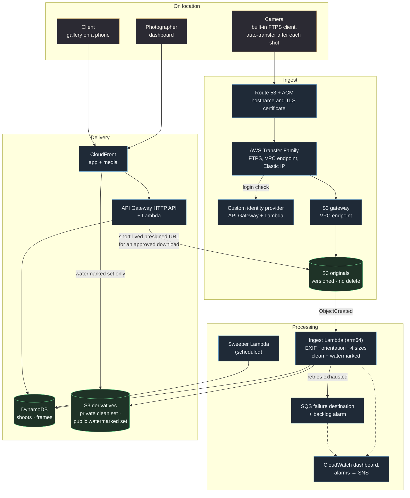

# Architecture

## Components

| Component | Role | Why it's built this way |
|---|---|---|
| **AWS Transfer Family (FTPS)** | Receives uploads directly from the camera's built-in client | Cameras already speak FTPS. A VPC-hosted endpoint lets a static Elastic IP stay attached across rebuilds, so the camera-side setting never changes. |
| **Custom identity provider** | API Gateway + Lambda that authenticates FTPS logins | Transfer Family's built-in user store only supports SFTP; FTPS requires a custom provider. |
| **S3 gateway VPC endpoint** | Routes S3 traffic from the VPC endpoint to S3 | Keeps ingest traffic on the AWS network, with no NAT gateway to pay for. |
| **S3 originals** | Stores every original frame | Versioned, and the ingest path has **no delete permission**, so the pipeline can add photos but never remove one. |
| **Ingest Lambda** | EXIF, orientation, four derivative sizes (320 / 800 / 1600 / 2400), clean and watermarked sets, frame record | Event-driven and arm64. Idempotent through a self-expiring lease (decision 2). |
| **SQS failure destination** | Holds events whose retries ran out | S3 doesn't redeliver events. Without a destination, a failed event would be gone. An alarm fires when anything lands here. |
| **Sweeper Lambda** | Finds frames stuck mid-processing and moves them to a visible state | A Lambda that times out runs no cleanup code, so something outside the failed run has to repair it. |
| **DynamoDB** | Shoots and frames, single-table design | Every read on the hot path is a single-key lookup (decision 3). |
| **S3 derivatives** | Two prefixes: a private clean set and a public watermarked set | CloudFront can read **only** the watermarked prefix. This boundary is enforced in the bucket policy. |
| **API Gateway HTTP API + Lambda** | Dashboard and gallery API | Pay-per-request. Downloads are issued as five-minute presigned URLs (decision 5). |
| **CloudFront** | Hosts the web app and serves the watermarked media | Cached previews keep egress cheap. Originals are never on the CDN. |
| **CloudWatch + SNS** | Ingest dashboard, latency and error-rate alarms, failure-queue backlog alarm | Alarms are defined in the same template as the resources they watch. |

## Environments and delivery

- **Infrastructure as code:** one AWS SAM / CloudFormation template defines the application, deployed as two stacks, **staging** and **production**.
- **CI/CD:** GitHub Actions authenticates to AWS with **OIDC**, so no long-lived keys are stored anywhere. Each environment has its own deploy role, and the staging role is explicitly denied every production resource.
- **Release flow:** a merge to `main` deploys staging automatically. Production deploys only by manual dispatch, after a staging check, and is followed by a written verification against the live resources.
- **Build:** Lambda functions target arm64 and are built in a container on an arm64 runner, so native image libraries match the runtime.
